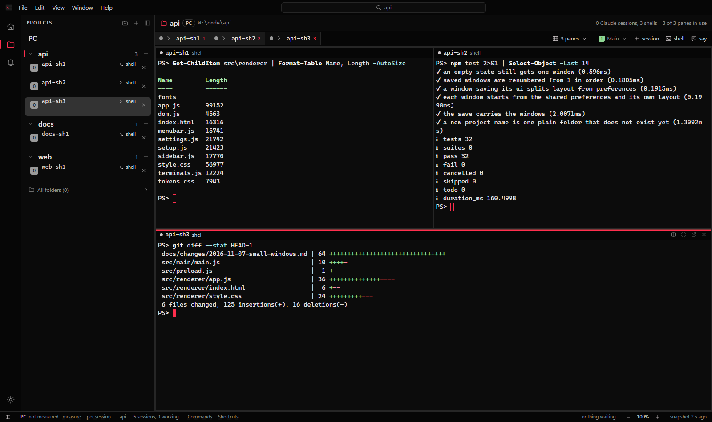
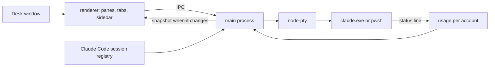
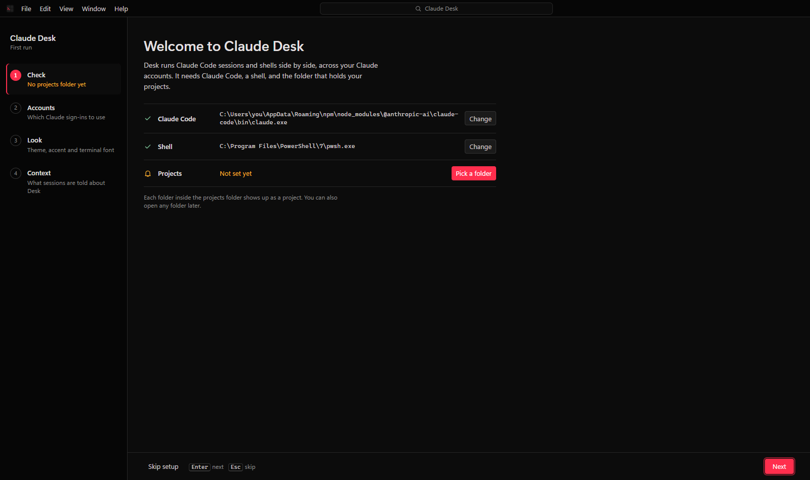
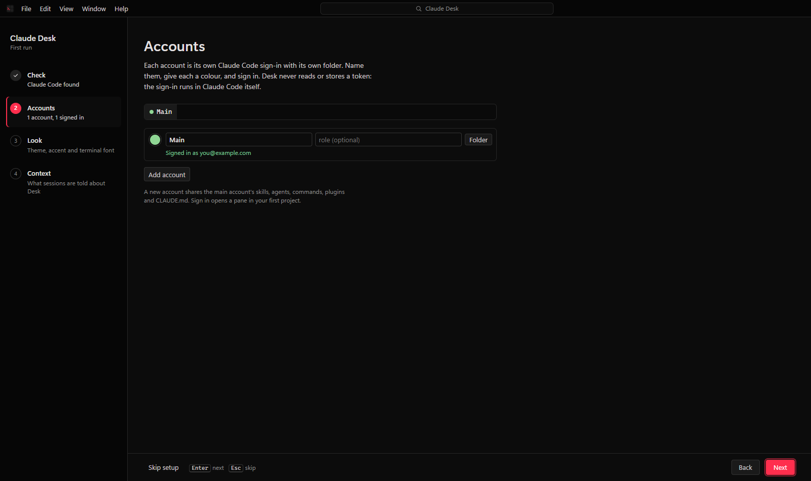
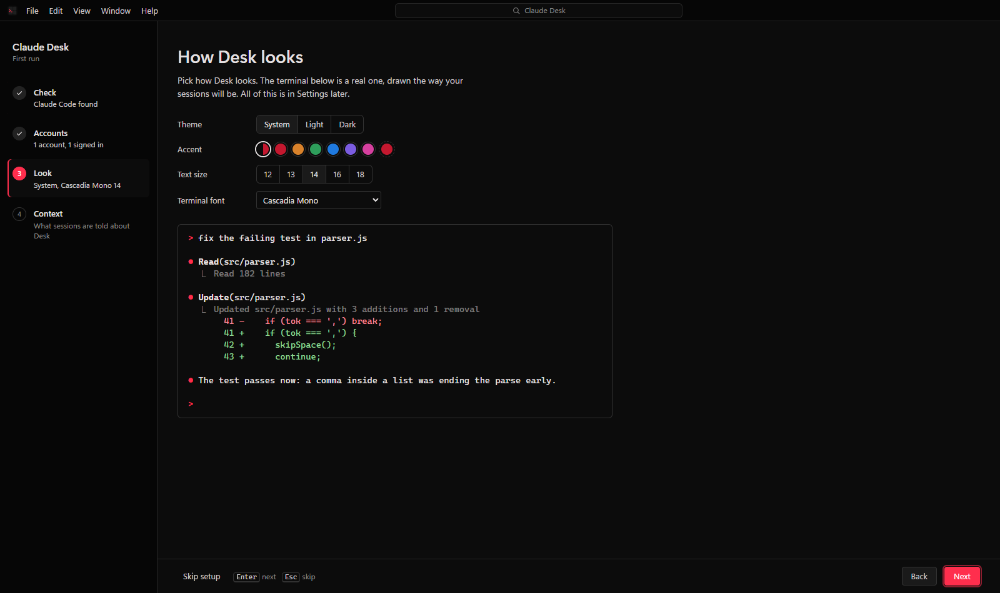
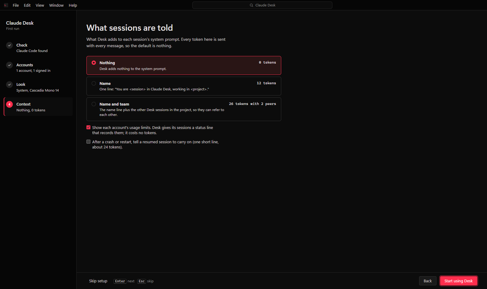
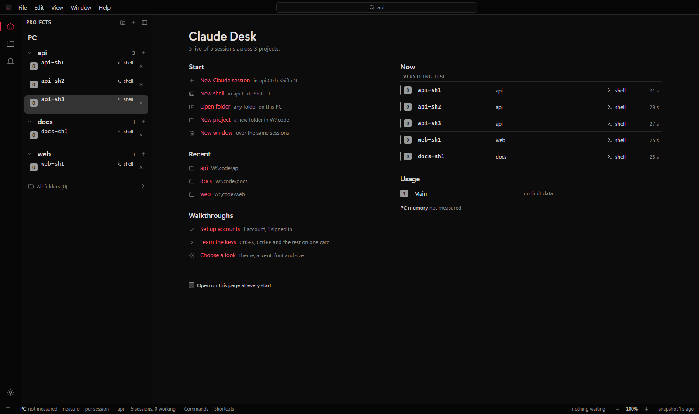
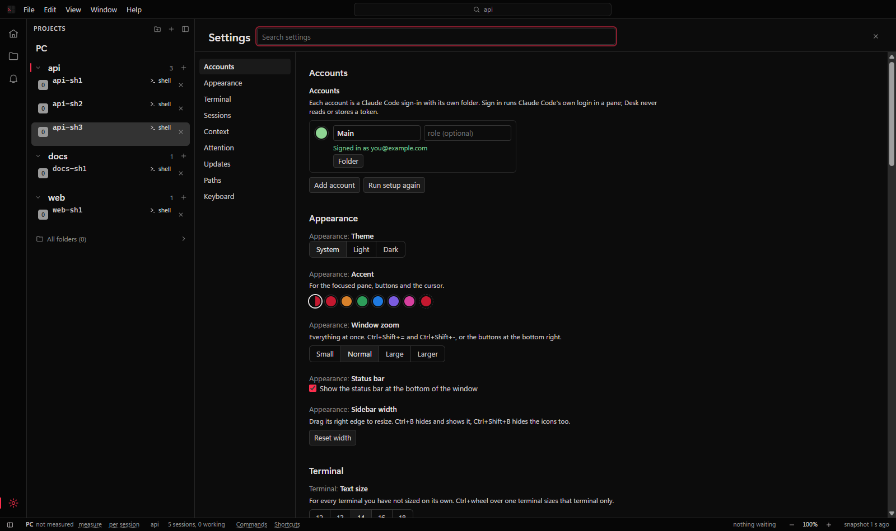
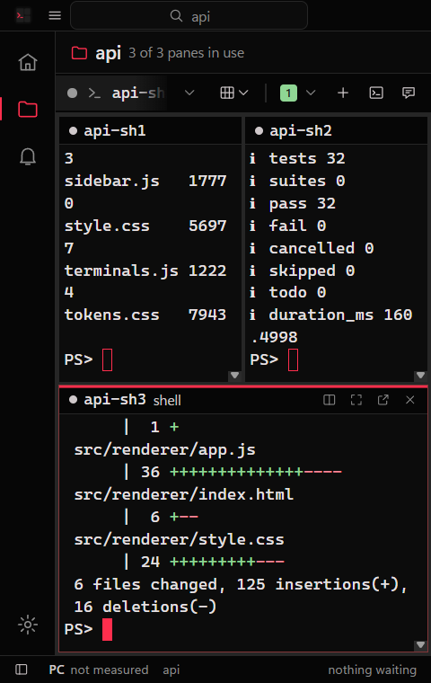
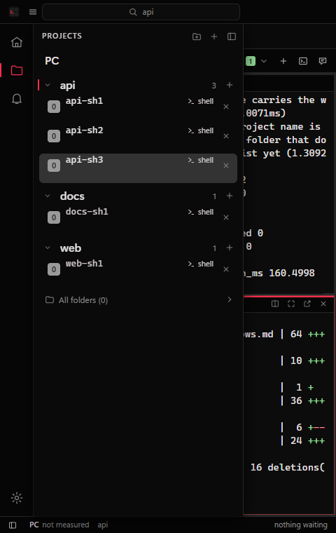

<div align="center">

# Claude Desk

**Run many Claude Code sessions, across several accounts, in one Windows app.**


[Docs](https://1onn.github.io/claude_desk/) | [Download](https://github.com/1oNN/claude_desk/releases) | [Issues](https://github.com/1oNN/claude_desk/issues)

</div>

Your projects are listed on the left, real `claude` terminals sit in tabs in the middle, and
you can show one to eight panes at once, in as many windows as you like. Sessions can belong
to different Claude accounts. Desk starts, shows, hides, stops and resumes them. It does not
wrap the chat, edit your files or show git. The terminal is Claude Code itself; Desk puts a
frame around it.



Claude Desk is an independent project. It is not made by or affiliated with Anthropic.

## Why

Running four or five Claude Code sessions means four or five terminal windows, a login per
account, and no way to see at a glance which one is waiting for you. Desk keeps them in one
place, marks the ones that need you, and gives each account its own config folder so logins
never mix. It adds nothing to your prompts unless you ask it to, so it costs no tokens.

## How it works



Each session is a node-pty child of the main process. The renderer draws it with xterm.js.
Desk reads Claude Code's own session registry to know which sessions are alive and what they
are called, and a small status line script it gives its own sessions to read usage. Nothing
goes through a server.

<details>
<summary><b>Accounts</b></summary>

Each account gets its own Claude Code config folder (`CLAUDE_CONFIG_DIR`), so logins, history
and settings stay apart. A new account's folder lives in Desk's data folder, or you can point
it at a config folder you already have.

Sign in runs Claude Code's own login in a pane, with that account's folder. Desk never sees,
reads or stores your token; Claude Code keeps it in that folder like it always does.

A new account shares your skills, agents, commands, plugins and `CLAUDE.md` with the main
account through directory junctions, so you keep one copy. Junctions need no admin rights.

</details>

<details>
<summary><b>Context and tokens</b></summary>

Desk can add a line to each session's system prompt. It is off by default.

| Setting | What Desk adds | About |
| --- | --- | --- |
| Nothing | nothing | 0 tokens |
| Name | "You are <name> in Claude Desk, working in <project>." | 12 tokens |
| Name and team | the name line plus the other sessions in the project | 26 tokens with 2 peers |

Token counts are characters divided by four, measured from the arguments Desk builds. When a
session is resumed after Desk was closed in the middle of a turn, an optional one-line note
(about 24 tokens) tells Claude to carry on. That is off by default too.

Usage limits (five-hour and seven-day, or cost this month for API-key accounts) come from the
status line Desk gives its own sessions, so they cost no tokens and make no network calls. If
an account already has its own `statusLine`, Desk leaves it alone and shows no usage for it.
The Usage page (the gauge in the activity bar, or View > Usage) lists every account with both
limits and when they reset, then each live Claude session on it with its model and how full its
context is.

</details>

<details>
<summary><b>Windows</b></summary>

File, New window opens a second window over the same
sessions. Each window keeps its own projects, panes and layout, and Desk reopens them all at
their saved size on the next start.

A session shows in one window at a time. Move pane to a new window (Ctrl+Shift+M) takes the
focused pane out; the process keeps running and its output carries on in the new window. The
old window marks it "in window 2". Closing a window that is not the last one only closes the
window. Closing the last one stops the sessions, as before.

</details>

<details>
<summary><b>Memory</b></summary>

Measured on Windows 11 with the build in this repo:

| | Private memory | Working set |
| --- | --- | --- |
| Desk idle, no sessions | about 200 MB | about 510 MB |
| Each extra window | about 45-50 MB | about 124 MB |

The main process grows about 11 MB per shell. The sessions themselves are what fill memory:
a Claude session is 400 MB or more and a shell about 100 MB (older figures, not re-measured
for this version). By default Desk starts only the sessions that were in the panes of the
project you were last on; the rest show a Resume button. A pane hidden for a minute drops its
terminal buffer and gets the last 128 KB back when shown again. Software painting in
Settings drops the GPU process, about 100 MB.

</details>

## Use it

### Install

You need Windows 10 or 11 and Claude Code installed, so that `claude` works in a terminal.
Desk finds `claude.exe` on its own, or you point it there in Settings. PowerShell 7 is used
for plain shells when it is installed; Windows PowerShell is the fallback.

Download `Claude-Desk-Setup-<version>.exe` from
[Releases](https://github.com/1oNN/claude_desk/releases) and run it. The installer is not code
signed yet, so SmartScreen will say it does not recognise the app. Click "More info", then
"Run anyway". It installs for your user only and needs no admin rights.

Or run it from source (Node.js 20 or newer; node-pty ships a prebuilt Windows binary, so no
compiler is needed):

```
git clone https://github.com/1oNN/claude_desk.git
cd claude_desk
npm ci
npm start
```

`start-desk.cmd` does the same and installs the dependencies on its first run. Only one copy
runs at a time; a second launch brings the first one forward.

### First run

Setup is a full window with four steps on the left. Every step can be skipped and changed
later in Settings.

| | |
| --- | --- |
|  |  |
|  |  |

1. **Check.** Whether Claude Code, the shell and your projects folder were found. Desk looks
   for `~\Projects`, `~\projects`, `~\source\repos`, `~\code`, `~\dev` and `~\src`, in that
   order.
2. **Accounts.** Your normal Claude Code login is the first account. Add more with a name and
   a colour.
3. **Look.** Theme, accent, window zoom and terminal font, with a live terminal to preview it.
4. **Context.** How much Desk tells each session about itself, with the token cost of each.

Then the Welcome page opens: start a session or shell, open a recent project, and see what
every session is doing.



### Menus

The title bar has File, Edit, View, Window and Help. Alt opens them when no terminal has
focus; inside a terminal Alt stays with Claude Code.

| Menu | Holds |
| --- | --- |
| File | new Claude session, new shell, new window, new project, open folder, settings, close window, exit |
| Edit | copy, paste, select all, say one message to the idle Claude sessions in the projects you tick |
| View | command palette, go to, home, projects, needs you, sidebar, panes 1-8, zoom, theme, full screen |
| Window | new window, move pane to a new window or another window, the window list |
| Help | welcome, keys, these docs, release notes, report an issue, the log and the state folder |

### Closing a session

The power icon in a pane head, or Close session in the pane menu, stops the session and
removes it from Desk. Close and delete transcript, in the pane menu, also deletes the
conversation file and the folder beside it. Both ask twice, and the second check starts on
Cancel, so Enter twice closes nothing. The pane's x only closes the pane and leaves the session
running. Shells and remote sessions have no delete option.

### Keys

Ctrl+/ or F1 shows the full list in the app.

| Key | Does |
| --- | --- |
| Ctrl+K | command palette |
| Ctrl+P | go to a session or project |
| Ctrl+Shift+N, Ctrl+Shift+T | new Claude session, new shell |
| Ctrl+Shift+M | move the focused pane to a new window |
| Ctrl+1 to 8, Ctrl+Shift+1 to 8 | focus a pane, set the number of panes |
| Ctrl+Tab, Ctrl+Shift+Tab | next or previous session in the pane |
| Ctrl+B, Ctrl+Shift+B | sidebar, whole left panel |
| Ctrl+=, Ctrl+-, Ctrl+0 | zoom the focused terminal |
| Ctrl+Shift+=, Ctrl+Shift+-, Ctrl+Shift+0 | zoom the whole window |
| Ctrl+wheel | zoom whatever is under the pointer |
| Ctrl+, | settings |
| F11 | full screen |
| Esc | close a menu or the palette, clear the toasts |

Ctrl+C copies when text is selected and otherwise goes to the terminal. Ctrl+V or right click
pastes; right click copies instead when text is selected. Ctrl+click opens a link. In the
sidebar, the arrows move, Enter opens, Right reaches a row's buttons and Delete stops a
session.

### Settings

Settings is a full page with a search box and a list of sections: Accounts, Appearance,
Terminal, Sessions, Context, Attention, Updates, Paths and Keyboard. A changed setting gets a
bar on the left and a reset button.



### Small windows

A window can be as small as 480 by 360. Under 900 wide the sidebar opens over the panes and
closes when you pick something, and under 640 the menus fold into one button.

| | |
| --- | --- |
|  |  |

## Known issues

| | |
| --- | --- |
| Windows only | The window frame, the shells and the account junctions are Windows code. |
| Unsigned installer | SmartScreen warns on first install until the app is code signed. |
| Mouse in Claude Code | Claude Code turns on mouse reporting, so selecting text in its pane needs Shift held while you drag. Right click pastes rather than opening a menu. |
| Memory | Every Claude session is its own process at 400 MB or more, so eight panes of Claude is several GB. Resume on demand is the default for that reason. |

## Settings and data

Settings are saved in `settings.json` in Desk's data folder:

- installed: `%APPDATA%\Claude Desk\`
- from source: `state\` in the repo folder

That folder also holds `accounts.json`, `desk.json` (projects, sessions, windows and layout)
and `desk.log`, which says what Desk did and why. Settings, Paths has buttons that open them.

An environment variable wins over the saved value:

| Variable | Sets |
| --- | --- |
| `DESK_PROJECTS` | the projects folder |
| `DESK_CLAUDE` | the Claude Code executable |
| `DESK_PWSH` | the shell |
| `DESK_STATE_DIR` | the data folder |
| `DESK_NO_UPDATE` | set to 1 to skip the update check |

## Updates

The installed app checks GitHub Releases a little after it starts and every six hours after
that. A new version downloads in the background and installs when you close Desk. Settings,
Updates shows your version, has a Check now button and can turn the check off. A copy run
from source never updates itself; use `git pull`.

## Privacy

Desk has no account, no telemetry and no server. It does not read or store Claude tokens. It
makes two kinds of network connection, and only these:

- the update check against `github.com/1oNN/claude_desk` releases, in the installed app,
  unless you turn it off;
- ssh to a remote machine, only if you set one up (below).

Claude Code itself talks to Anthropic as it always does.

## A remote machine (optional)

Desk can also run sessions on a Linux or macOS machine over ssh, inside tmux, and show them
next to your local ones. You need `ssh` key login, `tmux` and `claude` on that machine. Add
these to `settings.json`:

```json
{
  "remoteHost": "mybox",
  "remoteProjects": "projects",
  "laptopAccounts": [1, 2]
}
```

`remoteHost` is a `Host` entry in your `~\.ssh\config`. `remoteProjects` is a folder under
the remote home. `laptopAccounts` lists the account ids that may run there. Account 1 uses the
remote's own `~/.claude`; any other account gets `~/.claude-desk/accounts/<id>` and signs in
the first time it starts. Host keys are checked against your `known_hosts`.

## Reporting a problem

Open an [issue](https://github.com/1oNN/claude_desk/issues) with what you did, what you
expected and what happened, and attach `desk.log` (Help, Open the log). For a security
problem, see [SECURITY.md](SECURITY.md).

## Source

- `src/main/main.js`: windows, IPC, start queue, updates, close handling.
- `src/main/consts.js`: finds Claude Code, the shell and the projects folder; settings.
- `src/main/accounts.js`: the accounts store, sign-in state, shared setup.
- `src/main/sessions.js`: local sessions as node-pty children.
- `src/main/registry.js`: Claude Code's session registry, liveness, names.
- `src/main/usage.js` and `src/statusline.js`: usage from the status line.
- `src/main/laptop.js`: ssh, tmux and the remote poll.
- `src/main/memory.js`: process-tree memory.
- `src/main/state.js`: `desk.json`, with one record per window.
- `src/renderer/`: title bar and menus, sidebar, tabs and panes, terminals, palette, welcome,
  setup, settings.
- `test/`: `npm test`.

Plain JavaScript with no bundler. Runtime dependencies: Electron, node-pty, xterm and its fit
addon, ssh2 and electron-updater.

## License

MIT, see [LICENSE](LICENSE). Cascadia Mono is under the SIL Open Font License, see
[THIRD_PARTY_NOTICES.md](THIRD_PARTY_NOTICES.md).
