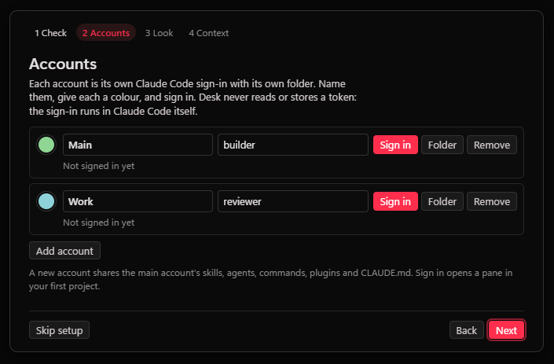
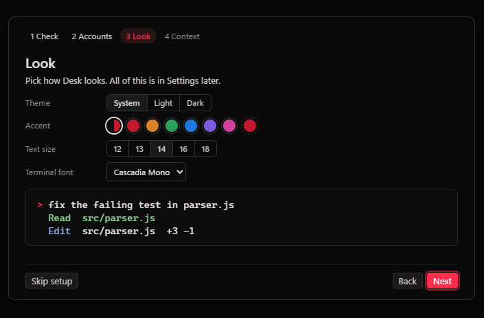

# Claude Desk

Claude Desk is a Windows app for running many Claude Code sessions side by side. Your
projects are listed on the left, real `claude` terminals sit in tabs in the middle, and you
can show one to four panes at once. Sessions can belong to different Claude accounts. Desk
starts, shows, hides, stops and resumes them. It does not wrap the chat, edit your files or
show git. The terminal is Claude Code itself; Desk puts a frame around it.





Claude Desk is an independent project. It is not made by or affiliated with Anthropic.

## What you need

- Windows 10 or 11.
- Claude Code installed, so that `claude` works in a terminal. Desk finds `claude.exe` on
  its own, or you point it there in Settings.
- To run from source only: Node.js 20 or newer. node-pty ships a prebuilt Windows binary,
  so no compiler is needed.

PowerShell 7 is used for plain shells when it is installed. Windows PowerShell is the fallback.

## Install

Download `Claude-Desk-Setup-<version>.exe` from
[Releases](https://github.com/1oNN/claude_desk/releases) and run it. The installer is not
code signed yet, so Windows SmartScreen will say it does not recognise the app. Click
"More info", then "Run anyway". It installs for your user only and needs no admin rights.

Or run it from source:

```
git clone https://github.com/1oNN/claude_desk.git
cd claude_desk
npm ci
npm start
```

`start-desk.cmd` does the same, and installs the dependencies on its first run. Only one
copy runs at a time; a second launch brings the first one forward.

## First run

Desk opens a short setup. Every step can be skipped and changed later in Settings.

1. **Check.** Shows whether Claude Code, the shell and your projects folder were found. Desk
   looks for `~\Projects`, `~\projects`, `~\source\repos`, `~\code`, `~\dev` and `~\src`, in
   that order. Change it here, or add single folders later from the sidebar.
2. **Accounts.** Your normal Claude Code login is the first account. Add more with a name and
   a colour.
3. **Look.** Theme (follow Windows, light or dark), an accent colour, the interface size and
   the terminal font.
4. **Context.** How much Desk tells each session about itself (see below).

Then pick a project and press the session button, or Ctrl+Shift+N. Shell opens a plain
PowerShell in the same folder.

## Several accounts

Add as many accounts as you like. Each one gets its own Claude Code config folder
(`CLAUDE_CONFIG_DIR`), so logins, history and settings stay apart. A new account's folder
lives in Desk's data folder, or you can point it at a config folder you already have.

Sign in runs Claude Code's own login in a pane, with that account's folder. Desk never sees,
reads or stores your token; Claude Code keeps it in that folder like it always does. Once
the login is done the account turns green.

A new account shares your skills, agents, commands, plugins and `CLAUDE.md` with the main
account through directory junctions, so you keep one copy. Junctions need no admin rights.

Every session wears its account's colour in the sidebar and tabs, and new sessions ask
which account to use.

## Context and tokens

Desk can add a line to each session's system prompt. It is off by default.

| Setting | What Desk adds | About |
| --- | --- | --- |
| Nothing | nothing | 0 tokens |
| Name | "You are <name> in Claude Desk, working in <project>." | 12 tokens |
| Name and team | the name line plus the other sessions in the project | 26 tokens with 2 peers |

Token counts are characters divided by four, measured from the arguments Desk builds. When
a session is resumed after Desk was closed in the middle of a turn, an optional one-line note
(about 24 tokens) tells Claude to carry on. That is off by default too.

## Usage

Desk shows each account's five-hour and seven-day limits, or its cost this month for API-key
accounts, in Settings and on the account row. It gets these from a status line it gives its
own sessions, so it costs no tokens and makes no network calls. If an account already has its
own `statusLine` in its settings, Desk leaves it alone and shows no usage for that account.
You can turn this off in Settings.

## Using it

- **Sidebar.** Projects with their sessions. The glyph is the session's state: working,
  waiting for you, finished, failed or idle. A session started outside Desk in the same
  folder shows greyed, so nothing gets opened twice. Ctrl+B hides the sidebar.
- **Tabs.** Every session of the current project. Click one to show it in the focused pane,
  or drag it onto a pane.
- **Home.** Every session across all projects, the ones that need you first, with how long
  they have waited. The bell counts them, and so does the window title.
- **Say.** Sends one message to every idle Claude session in the project. Busy sessions are
  skipped and named, because typed text would answer whatever prompt they have open.
- **Stop and Resume.** Stop keeps the session; Resume brings the same conversation back by its
  session id. Forget removes it from Desk. Transcripts stay where Claude Code puts them.
- Closing the window stops the sessions it hosts. On the next start the saved sessions come
  back one at a time.

## Keys

Ctrl+/ or F1 shows the full list in the app.

| Key | Does |
| --- | --- |
| Ctrl+K | command palette |
| Ctrl+P | jump to a session or project |
| Ctrl+Shift+N, Ctrl+Shift+T | new Claude session, new shell |
| Ctrl+1 to 4, Ctrl+Shift+1 to 4 | focus a pane, set the number of panes |
| Ctrl+Tab | next session in the pane |
| Ctrl+B | hide or show the sidebar |
| Ctrl+= and Ctrl+-, Ctrl+0 | bigger or smaller interface, reset |
| Ctrl+, | settings |
| Esc | close a menu or the palette, clear the toasts |

In the sidebar, Up and Down move, Enter opens, Right reaches a row's buttons and Delete stops
a session. Every other key goes to the terminal.

## Updates

The installed app checks GitHub Releases for a new version a little after it starts and
every six hours after that. A new version downloads in the background and installs when you
close Desk. Settings, Updates shows your version, has a Check now button and can turn the
check off. A copy run from source never updates itself; use `git pull`.

## Privacy

Desk has no account, no telemetry and no server. It does not read or store Claude tokens.
It makes two kinds of network connection, and only these:

- the update check against `github.com/1oNN/claude_desk` releases, in the installed app,
  unless you turn it off;
- ssh to a remote machine, only if you set one up (below).

Claude Code itself talks to Anthropic as it always does.

## Settings and data

Settings covers the theme, accent, interface and terminal sizes, the terminal font, the
sidebar width, the taskbar flash and notifications when a session needs you, which sessions
start with Desk, GPU or software painting, the accounts, context, usage, updates and the
paths. They are saved in `settings.json` in Desk's data folder:

- installed: `%APPDATA%\Claude Desk\`
- from source: `state\` in the repo folder

That folder also holds `accounts.json`, `desk.json` (your projects, sessions and layout) and
`desk.log`, which says what Desk did and why. Settings has buttons that open them.

An environment variable wins over the saved value:

| Variable | Sets |
| --- | --- |
| `DESK_PROJECTS` | the projects folder |
| `DESK_CLAUDE` | the Claude Code executable |
| `DESK_PWSH` | the shell |
| `DESK_STATE_DIR` | the data folder |
| `DESK_NO_UPDATE` | set to 1 to skip the update check |

## A remote machine (optional)

Desk can also run sessions on a Linux or macOS machine over ssh, inside tmux, and show them
next to your local ones. You need `ssh` key login, `tmux` and `claude` on that machine. Add
these to `settings.json`:

```json
{
  "remoteHost": "mybox",
  "remoteProjects": "projects",
  "laptopAccounts": [1, 2]
}
```

`remoteHost` is a `Host` entry in your `~\.ssh\config`. `remoteProjects` is a folder under
the remote home. `laptopAccounts` lists the account ids that may run there. Account 1 uses the
remote's own `~/.claude`; any other account gets `~/.claude-desk/accounts/<id>` and signs in
the first time it starts. Host keys are checked against your `known_hosts`.

## Memory

Desk itself is about 500 MB across its processes. Each Claude session is 400 MB or more and
each shell about 100 MB, so sessions are what fill memory. By default Desk starts only the
sessions that were in the panes of the project you were last on; the rest show a Resume
button. A pane hidden for a minute drops its terminal buffer and gets the last 128 KB back
when shown again. Software painting in Settings drops the GPU process, about 100 MB.

## Reporting a problem

Open an [issue](https://github.com/1oNN/claude_desk/issues) with what you did, what you
expected and what happened, and attach `desk.log`. For a security problem, see
[SECURITY.md](SECURITY.md).

## Source

- `src/main/main.js`: window, IPC, start queue, updates, close handling.
- `src/main/consts.js`: finds Claude Code, the shell and the projects folder; settings.
- `src/main/accounts.js`: the accounts store, sign-in state, shared setup.
- `src/main/sessions.js`: local sessions as node-pty children.
- `src/main/registry.js`: Claude Code's session registry, liveness, names.
- `src/main/usage.js` and `src/statusline.js`: usage from the status line.
- `src/main/laptop.js`: ssh, tmux and the remote poll.
- `src/main/memory.js`: process-tree memory.
- `src/main/state.js`: `desk.json`.
- `src/renderer/`: sidebar, tabs and panes, terminals, palette, home, setup, settings.
- `test/`: `npm test`.

Plain JavaScript with no bundler. Runtime dependencies: Electron, node-pty, xterm and its fit
addon, ssh2 and electron-updater.

## License

MIT, see [LICENSE](LICENSE). Cascadia Mono is under the SIL Open Font License, see
[THIRD_PARTY_NOTICES.md](THIRD_PARTY_NOTICES.md).
